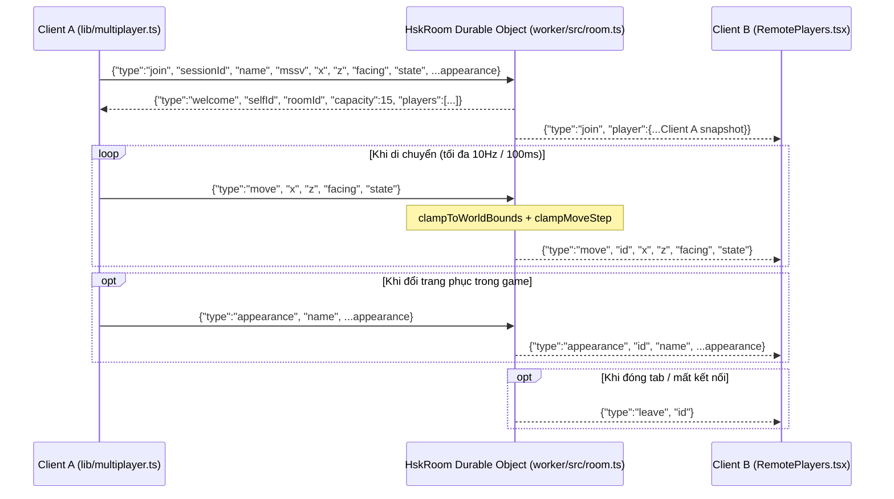

# Kiến trúc Multiplayer Realtime (`Multiplayer Architecture`)

## 1. Tổng quan & Nguồn Sự thật Hợp đồng (`shared/contracts/multiplayer.ts`)

Hệ thống Multiplayer cho phép sinh viên nhìn thấy nhau theo thời gian thực trên sân trường 3D với đầy đủ tên, MSSV (8 chữ số), hướng di chuyển, trạng thái đi bộ/chạy/lái xe và 10 mẫu đồng phục HUST.

Mọi hằng số, kiểu dữ liệu và hàm kiểm tra hợp lệ được khai báo duy nhất tại [`shared/contracts/multiplayer.ts`](file:///home/bao/Hust3D/hust-hsk/shared/contracts/multiplayer.ts):

- **Danh sách Phòng (`ROOM_IDS`):** `['hsk-1', 'hsk-2', 'hsk-3', 'hsk-4', 'hsk-5']`, sức chứa tối đa `ROOM_CAPACITY = 15` người/phòng.
- **Giới hạn Tốc độ & Tần suất Gói tin:**
  - `MAX_SPEED_WALK = 12 m/s` (cho phép dung sai jitter mạng trên tốc độ chạy bộ `10 m/s`).
  - `MAX_SPEED_RIDE = 18 m/s` (cho phép dung sai jitter mạng trên tốc độ xe máy `14 m/s`).
  - `MAX_MSG_PER_SEC = 20` bản tin/giây trên mỗi kết nối.
- **Ngoại hình Đồng bộ (`RemoteAppearance`):**
  - `gender`: `'male' | 'female'`
  - `outfit`: 10 mã đồng phục (`'windbreaker-hust'`, `'bomber-red-grey'`, `'bomber-navy-white'`, `'bomber-red-navy'`, `'polo-red'`, `'hoodie-hust'`, `'shirt-white'`, `'sport-pe'`, `'tshirt-navy'`, `'sweater-cream'`)
  - `hairStyle`: 6 kiểu tóc (`'short'`, `'swept'`, `'layered'`, `'ponytail'`, `'bob'`, `'bun'`)
  - `skirt`, `glasses`, `backpack`: `boolean`

---

## 2. Giao thức Bản tin WebSocket (Wire Protocol)

Kết nối WebSocket được thiết lập tới `wss://<worker-host>/ws?room=<roomId>`:

---

## 3. Cơ chế WebSocket Hibernation trên Cloudflare Durable Object

Trong [`worker/src/room.ts`](file:///home/bao/Hust3D/hust-hsk/worker/src/room.ts), class [`HskRoom`](file:///home/bao/Hust3D/hust-hsk/worker/src/room.ts#L50-L280) sử dụng **Cloudflare Durable Object WebSocket Hibernation API** (`this.ctx.acceptWebSocket(server)`) để tiết kiệm chi phí thời gian chờ khi người chơi đứng yên:

1. **Lưu trữ Trạng thái vào Socket Attachment (`persistSocketAttachment`):**
   - Mỗi khi xử lý `join`, `move`, `state`, hoặc `appearance`, server gọi `ws.serializeAttachment(attachment)` để ghi toàn bộ [`SocketAttachment`](file:///home/bao/Hust3D/hust-hsk/worker/src/room.ts#L31-L48) (`id`, `roomId`, `name`, `mssv`, `color`, `x`, `z`, `facing`, `state`, ngoại hình và `lastUpdate`) gắn trực tiếp vào kết nối WebSocket.
2. **Khôi phục Phiên khi Thức dậy (`restoreHibernatedSessions`):**
   - Khi Durable Object bị giải phóng khỏi bộ nhớ RAM trong lúc rỗi rồi được đánh thức bởi một bản tin WebSocket hoặc truy vấn HTTP `/__count`, phương thức [`restoreHibernatedSessions`](file:///home/bao/Hust3D/hust-hsk/worker/src/room.ts#L99-L133) quét `this.ctx.getWebSockets()`, đọc `ws.deserializeAttachment()` và tái lập tức thì `this.sessions` cùng `this.bySocket`.
3. **Chống Nhân bản Phiên khi Reconnect:**
   - Nếu cùng một `sessionId` gửi bản tin `join` trên một kết nối WebSocket mới trước khi kết nối cũ kịp đóng, server tự động đóng socket cũ và ghi đè phiên hiện tại để sĩ số phòng luôn chính xác.

---

## 4. Nội suy Chuyển động & Hiển thị Bảng tên ở Client (`RemotePlayers.tsx`)

- [`RemotePlayers.tsx`](file:///home/bao/Hust3D/hust-hsk/components/three/RemotePlayers.tsx) nhận danh sách người chơi từ [`lib/multiplayer.ts`](file:///home/bao/Hust3D/hust-hsk/lib/multiplayer.ts) và nội suy mượt (`exponential smoothing`, hệ số `k = 10`) vị trí `(x, z)` cùng góc quay ngắn nhất `shortAngleDist(cur.facing, target.facing)` trong mỗi frame.
- **Quy tắc chống xoay kép (`Anti-Double-Rotation`):** `groupRef` ngoài cùng chỉ cập nhật `position` (tuyệt đối không gán `rotation.y`), còn `figureRef` bên trong mới xoay theo `facing`. Nhờ đó `<Billboard>` chứa bảng tên `"Tên (MSSV)"` luôn hướng thẳng về phía camera mà không bị lật ngược hay xoay lệch.
