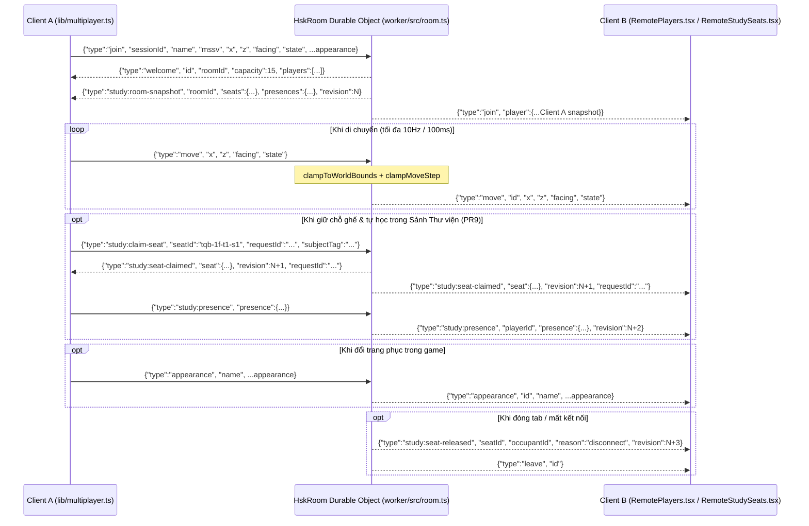

# Kiến trúc Multiplayer Realtime (`Multiplayer Architecture`)

## 1. Tổng quan & Nguồn Sự thật Hợp đồng (`shared/contracts/multiplayer.ts`)

Hệ thống Multiplayer cho phép sinh viên nhìn thấy nhau theo thời gian thực trên sân trường 3D với đầy đủ tên, MSSV (8 chữ số), hướng di chuyển, trạng thái đi bộ/chạy/lái xe, 10 mẫu đồng phục HUST, cũng như trạng thái ngồi học có thẩm quyền server tại Sảnh tầng 1 Thư viện Tạ Quang Bửu (`PR9` — chi tiết tại [`docs/architecture/study-rooms.md`](./study-rooms.md)).

Mọi hằng số, kiểu dữ liệu và hàm kiểm tra hợp lệ được khai báo duy nhất tại [`shared/contracts/multiplayer.ts`](../../shared/contracts/multiplayer.ts) và [`shared/contracts/study.ts`](../../shared/contracts/study.ts):

- **Danh sách Phòng (`ROOM_IDS`):** `['hsk-1', 'hsk-2', 'hsk-3', 'hsk-4', 'hsk-5']`, sức chứa tối đa `ROOM_CAPACITY = 15` người/phòng.
- **Giới hạn Tốc độ & Tần suất Gói tin:**
  - `MAX_SPEED_WALK = 12 m/s` (cho phép dung sai jitter mạng trên tốc độ chạy bộ `10 m/s`).
  - `MAX_SPEED_RIDE = 18 m/s` (cho phép dung sai jitter mạng trên tốc độ xe máy `14 m/s`).
  - `MAX_MSG_PER_SEC = 20` bản tin/giây trên mỗi kết nối.
  - `MAX_STUDY_WS_PAYLOAD_BYTES = 2048` byte cho các gói tin phòng tự học.
- **Ngoại hình Đồng bộ (`RemoteAppearance`):**
  - `gender`: `'male' | 'female'`
  - `outfit`: 10 mã đồng phục (`'windbreaker-hust'`, `'bomber-red-grey'`, `'bomber-navy-white'`, `'bomber-red-navy'`, `'polo-red'`, `'hoodie-hust'`, `'shirt-white'`, `'sport-pe'`, `'tshirt-navy'`, `'sweater-cream'`)
  - `hairStyle`: 6 kiểu tóc (`'short'`, `'swept'`, `'layered'`, `'ponytail'`, `'bob'`, `'bun'`)
  - `skirt`, `glasses`, `backpack`: `boolean`

---

## 2. Giao thức Bản tin WebSocket & Xác thực Endpoint (`Wire Protocol & Endpoint Security`)

Kết nối WebSocket được thiết lập tới `wss://<worker-host>/ws?room=<roomId>` thông qua [`resolveWsUrl`](../../lib/multiplayer.ts) và [`validateWsEndpointUrl`](../../lib/multiplayer.ts):

- **Bảo mật Endpoint (`Anti-Redirect / FIX 1`):**
  - Client **tuyệt đối không** đọc tham số URL `?mpWs=` từ thanh địa chỉ trình duyệt để ghi đè máy chủ WebSocket, ngăn chặn tấn công lừa đảo qua liên kết độc hại đánh cắp `sessionId` hoặc `mssv` trong bản tin `join`.
  - Tham số URL chỉ được phép chọn mã phòng hợp lệ (`?room=hsk-1`..`hsk-5`).
  - Trên môi trường Production, chỉ chấp nhận giao thức mã hóa `wss:` tới host tin cậy (`TRUSTED_PROD_WS_HOSTS` hoặc host cấu hình lúc build).
  - Trong môi trường phát triển cục bộ hoặc kiểm thử tự động Playwright trên `127.0.0.1` / `localhost`, có thể chỉ định `window.__HUST_TEST_MP_WS_URL` và giá trị này bắt buộc phải trỏ tới địa chỉ loopback (`127.0.0.1`, `localhost`, `[::1]`).
- **Ràng buộc `1 WebSocket = 1 sessionId` (`FIX 4`):**
  - Trên [`HskRoom`](../../worker/src/room.ts), một kết nối WebSocket sau khi đã `join` thành công với `sessionId` A không được phép gửi `join` đổi sang `sessionId` B (server trả lỗi `Socket is already bound to a different sessionId`), ngăn chặn việc tạo phiên/ghế mồ côi không thể giải phóng khi đóng socket.

---

## 3. Cơ chế WebSocket Hibernation trên Cloudflare Durable Object

Trong [`worker/src/room.ts`](../../worker/src/room.ts), class [`HskRoom`](../../worker/src/room.ts) sử dụng **Cloudflare Durable Object WebSocket Hibernation API** (`this.ctx.acceptWebSocket(server)`) để tiết kiệm chi phí thời gian chờ khi người chơi đứng yên hoặc đang tập trung học Pomodoro:

1. **Lưu trữ Trạng thái vào Socket Attachment (`persistSocketAttachment`):**
   - Mỗi khi xử lý `join`, `move`, `state`, `appearance`, `study:claim-seat`, `study:release-seat` hoặc `study:presence`, server gọi `ws.serializeAttachment(attachment)` để ghi toàn bộ [`SocketAttachment`](../../worker/src/room.ts) (`id`, `roomId`, `name`, `mssv`, `color`, `x`, `z`, `facing`, `state`, ngoại hình, `seatId`, `occupiedAtMs`, `studyPresence`, `studyRevision` và `lastUpdate`) gắn trực tiếp vào kết nối WebSocket.
2. **Khôi phục Phiên & Sổ Ghế khi Thức dậy (`restoreHibernatedSessions`):**
   - Khi Durable Object bị giải phóng khỏi bộ nhớ RAM trong lúc rỗi rồi được đánh thức bởi một bản tin WebSocket hoặc truy vấn HTTP `/__count`, phương thức [`restoreHibernatedSessions`](../../worker/src/room.ts) quét `this.ctx.getWebSockets()`, đọc `ws.deserializeAttachment()` và tái lập tức thì `this.sessions`, `this.bySocket`, `this.seatRegistry`, `this.presences` cùng `this.studyRevision`.
3. **Chống Nhân bản Phiên & Bảo toàn Ghế khi Reconnect:**
   - Nếu cùng một `sessionId` gửi bản tin `join` trên một kết nối WebSocket mới trước khi kết nối cũ kịp đóng, server tự động đóng socket cũ mà không xóa quyền giữ chỗ ghế đang thuộc về `sessionId` đó, đồng thời gửi ngay `study:room-snapshot` mới nhất.

---

## 4. Nội suy Chuyển động & Hiển thị Bảng tên ở Client (`RemotePlayers.tsx` & `RemoteStudySeats.tsx`)

- **Ngoài sân trường ([`RemotePlayers.tsx`](../../components/three/RemotePlayers.tsx)):**
  - Nhận danh sách người chơi từ [`lib/multiplayer.ts`](../../lib/multiplayer.ts) (tự động ẩn những sinh viên đang ngồi trong sảnh thư viện để tránh vẽ trùng ở cửa sảnh ngoài trời) và nội suy mượt (`exponential smoothing`, hệ số `k = 10`) vị trí `(x, z)` cùng góc quay ngắn nhất `shortAngleDist(cur.facing, target.facing)` trong mỗi frame.
- **Trong Sảnh tầng 1 Thư viện ([`RemoteStudySeats.tsx`](../../features/social/rooms/RemoteStudySeats.tsx)):**
  - Dựng mô hình 3D sinh viên khác đang ngồi học tại đúng tọa độ ghế trong `STUDY_SEATS` với tư thế ngồi `computeSeatedPoseTargets`, kèm bảng `<Billboard>` 2 dòng hiển thị tên, trạng thái khóa ghế và môn học/pha Pomodoro hiện tại (không bao giờ hiển thị MSSV).
- **Quy tắc chống xoay kép (`Anti-Double-Rotation`):** `groupRef` ngoài cùng chỉ cập nhật `position` (tuyệt đối không gán `rotation.y`), còn `figureRef` bên trong mới xoay theo `facing`. Nhờ đó `<Billboard>` chứa bảng tên luôn hướng thẳng về phía camera mà không bị lật ngược hay xoay lệch.
