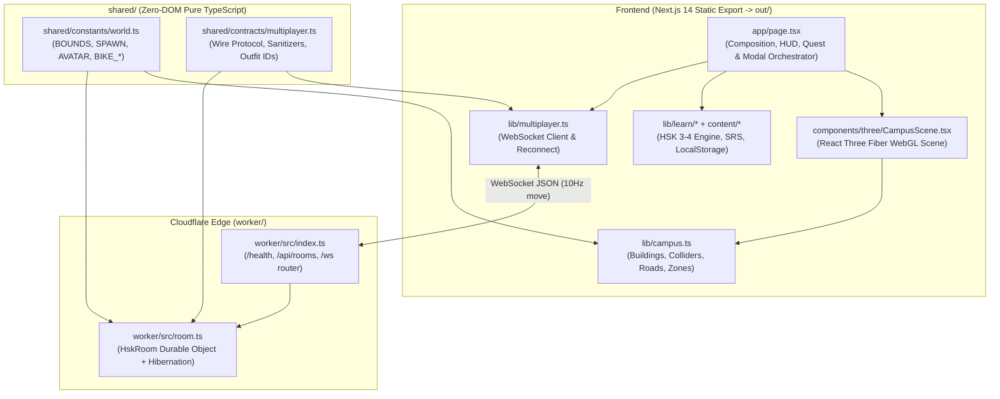

# Tổng quan Kiến trúc Hệ thống (`Architecture Overview`)

## 1. Bức tranh Tổng thể (High-Level Topology)

**HUSTVerse — Bách Khoa 3D** được thiết kế theo mô hình **Static WebGL Client + Serverless Realtime Edge** kết hợp kiến trúc **Core World + Pluggable Modes (`lib/gameModes.ts`)**, gồm 3 khối thực thi chính dùng chung một tầng hợp đồng dữ liệu (`shared/`):



---

## 2. Kiến trúc Hiện tại vs. Kiến trúc Mục tiêu (Modular Monolith)

### Cấu trúc Thư mục Hiện tại (Sau `PR1` & `PR2`)
```text
app/                    # Next.js App Router (layout.tsx, page.tsx)
components/
  learn/                # Giao diện học tập (QuestPanel, Handbook, ReviewSession, ResultPanel)
  three/                # Toàn bộ 3D Scene, Tòa nhà, Nhân vật, Xe máy, Vật liệu PBR
  ui/                   # Joystick, Minimap, CharacterCreatorModal
content/                # 1.057 từ vựng HSK 3 (bài 10–18) & HSK 4 (bài 1–20)
lib/
  learn/                # Thuật toán SRS, chấm Pinyin/Hán tự, Quest registry, Huy hiệu
  campus.ts             # Single source of truth dữ liệu thế giới 3D & va chạm
  playerState.ts        # Trạng thái frame mutable (60fps)
  identity.ts           # Hồ sơ người chơi & lưu trữ localStorage
  multiplayer.ts        # Client WebSocket kết nối Cloudflare Worker
shared/
  constants/world.ts    # Biên thế giới (BOUNDS), SPAWN, AVATAR, BIKE_*
  contracts/multiplayer.ts # Hợp đồng kiểu dữ liệu & hàm kiểm tra Client/Server
worker/
  src/                  # Cloudflare Worker + Durable Object HskRoom
docs/                   # Tài liệu kiến trúc, đặc tả thế giới, ADRs & cổng kiểm thử
tham-khao/              # Tư liệu ảnh chụp thực tế khuôn viên & đồng phục ĐHBK Hà Nội
test/                   # Unit tests, mô phỏng đi bộ A*, WebSocket shim & Playwright tests
```

### Kiến trúc Đích (Target Modular Monolith — Định hướng `PR3`–`PR6`)
```text
app/                    # Next.js routing & top-level composition
features/
  campus/               # scene/, buildings/, landscape/, navigation/, interaction/, world-data/
  avatar/               # rig/, appearance/, animation/, ui/
  learning/             # hsk/ (SRS engine, quests, handbook)
  study/                # pomodoro/, study-session/, focus-mode/
  social/               # multiplayer/, rooms/, presence/
shared/
  contracts/            # Hợp đồng giao thức dùng chung Frontend & Worker
  constants/            # Hằng số thế giới chuẩn xác
  ui/                   # Primitive UI dùng chung
worker/src/             # Cloudflare Worker & Durable Objects
docs/                   # Tài liệu kiến trúc chuẩn hóa
tham-khao/              # Tư liệu tham khảo thực tế
test/                   # Hệ thống kiểm thử tự động
```

---

## 3. Quy tắc Ranh giới Kiến trúc (Architectural Invariants)

1. **Không phụ thuộc ngược vào `shared/`:**
   - Mọi file trong `shared/` phải là TypeScript thuần túy, **cấm** import React, Three.js, `@react-three/fiber`, hay các API chỉ có trên trình duyệt (`window`, `document`, `localStorage`).
2. **Độc lập giữa Nghiệp vụ Học tập và WebGL:**
   - `lib/learn/*` và `content/*` (cũng như `features/study/pomodoro` trong tương lai) không được import bất kỳ module nào từ `components/three/*` hay `three`. Toàn bộ logic học tập và tính giờ phải chạy và kiểm thử được trên Node.js thuần.
3. **Không biến React State thành nút cổ chai 60 FPS:**
   - Vị trí người chơi, vận tốc xe máy, góc xoay camera mỗi khung hình (`useFrame`) chỉ được ghi vào object mutable (`lib/playerState.ts`), không gọi `setState` của React ở tần số 60 Hz.
4. **Duy trì Tương thích Ngược qua Re-export Facades:**
   - Trong suốt quá trình chuyển dịch từ `lib/*` và `components/*` sang `features/*` (`PR3`–`PR5`), các đường dẫn import cũ phải được giữ tương thích thông qua re-export để không làm gãy các bài kiểm thử hồi quy.
