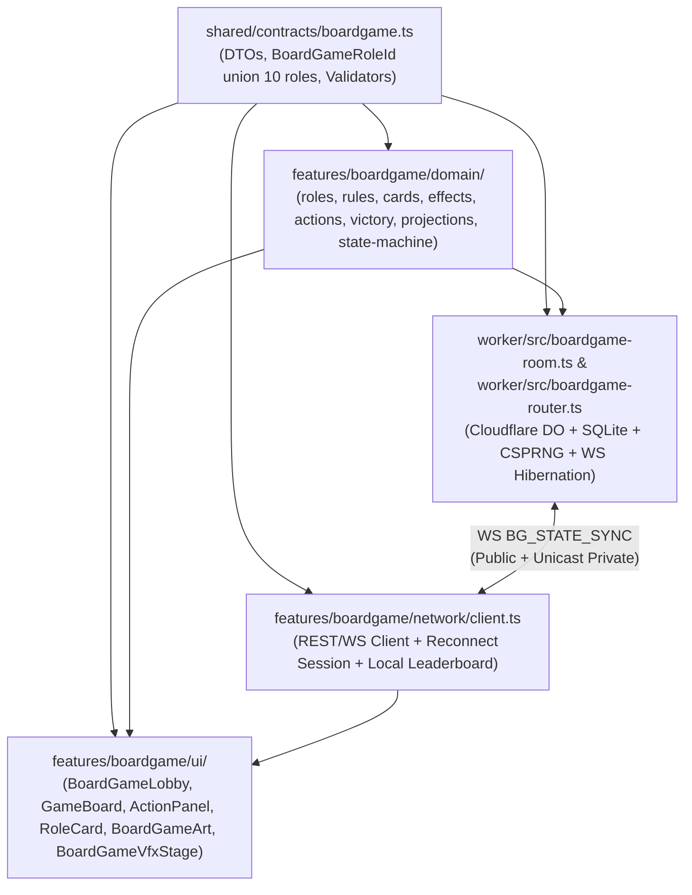

# Bóng Đêm KTX — Phase 0: Current Architecture Audit & Dependency Map

> **Mục đích:** Kiểm toán toàn diện kiến trúc hệ thống Board Game **"Bóng Đêm KTX v4"** (10 tướng Classic) trên nhánh `main` làm cơ sở an toàn cho việc mở rộng lên 66 tướng (`Classic 10 + Expansion 1 (26) + Expansion 2 (30)`).
> **Trạng thái Classic:** **100% bất biến trong Phase 0** — không sửa gameplay, RNG, worker hay contracts.

---

## 1. Tổng quan Kiến trúc Hiện tại (Single Source of Truth)

### Luồng thực thi chuẩn (Server-Authoritative)
1. **Tạo phòng (`POST /api/boardgame/matches`):** `worker/src/boardgame-router.ts` sinh `matchId` (`bg_<16 hex>`) và `inviteCode` (6 ký tự CSPRNG), đăng ký vào `BG_DIRECTORY_ROOM_NAME` DO, gọi `POST /__init` trên Match DO (`BoardGameRoom`).
2. **Sảnh chờ & Ghế (`BG_JOIN`, `BG_SELECT_SEAT`, `BG_SET_READY`):** `BoardGameRoom` lưu vào SQLite (`matches`, `match_players` có unique partial index `idx_mp_seat_unique`), cấp `reconnectToken` 256-bit CSPRNG (chỉ lưu `SHA-256` hex trong SQLite).
3. **Khởi tạo ván (`BG_START_MATCH`):** `BoardGameRoom.handleStartMatch` sinh `seed` 32-bit CSPRNG, gọi `createInitialGameState(...)` trong `features/boardgame/domain/state-machine.ts`, lưu `{ rulesetVersion: 4, engineState }` vào `matches.game_state_json`, xóa `processed_requests`, và broadcast `BG_STATE_SYNC` riêng cho từng socket (`getPublicGameView` công khai + `getPrivateGameView` unicast cho đúng `playerId`, `null` cho Spectator).
4. **Hành động trong ván (`BG_GAME_ACTION`):** Kiểm tra idempotency (`processed_requests`), rate limit (`25ms`), optimistic concurrency (`expectedRevision === match.revision`), strict payload schema (`validateBoardGameActionPayload`), gọi `applyPlayerGameAction(engineState, playerId, action, nowMs)`, lưu lại JSON, cập nhật revision + alarm, và broadcast sync.

---

## 2. Kiểm kê toàn bộ Logic Hardcode theo `roleId` (Dependency Map)

### 2.1. Shared Contracts (`shared/contracts/boardgame.ts`)
| Vị trí | Chi tiết hardcode | Rủi ro khi mở rộng 66 tướng |
|---|---|---|
| `L65-L75` | `BoardGameRoleId` là closed union 10 literal (`'gac-ky-thuat' \| ... \| 'lang-tien-phong'`) | Mở rộng lên 66 tướng yêu cầu mở rộng type hoặc tách `ClassicBoardGameRoleId` và `BoardGameRoleId` tổng quát mà không làm gãy typecheck ở các map UI (`Record<BoardGameRoleId, ...>`). |
| `L29` | `BOARD_GAME_RULESET_VERSION = 4` (chỉ có số version integer, chưa có khái niệm `rulesetId` / `catalogVersion`) | Không phân biệt được `classic` vs `expansion-1` vs `expansion-2` vs `full-expansion`. |
| `L405-L419` | `BoardGameStateSyncMessage` & `BoardGameMatchSummary` chưa mang trường `rulesetId` / `catalogVersion` | Client & Spectator không biết phòng đang chọn ruleset nào trước khi bắt đầu. |
| `L513-L517`, `L978-L1001` | `CLIENT_MSG_ALLOWED_KEYS` whitelist chặt các message & keys; chưa có `BG_SET_RULESET` và `BG_START_MATCH` chưa khóa `rulesetId` | Mọi message mới phải được khai báo vào whitelist anti-prototype-pollution. |

### 2.2. Domain — Danh mục & Phân vai (`features/boardgame/domain/roles.ts`, `state-machine.ts`, `types.ts`)
| File & Dòng | Logic hardcode | Tác động |
|---|---|---|
| `roles.ts:18-174` | `ROLES_CATALOG` mảng tĩnh 10 tướng Classic | Không có phân tách `CharacterRegistry`, `RulesetRegistry`, `CharacterAvailability`, hay `implementationStatus`. |
| `roles.ts:176-187` | `ROLES_BY_ID: Record<BoardGameRoleId, CharacterDesign>` tra trực tiếp 10 phần tử | Tra cứu `getRoleDesign(id)` giả định mọi ID đều tồn tại trong 10 tướng Classic. |
| `roles.ts:199-213` | `getRoleDistribution(playerCount)` chia phe cố định cho 4–8 người: `4P (2/2/0)`, `5P (2/2/1)`, `6P (2/2/2)`, `7P (2/2/3)`, `8P (3/3/2)` | Cần giữ nguyên bảng chia phe này khi mở rộng pool tướng theo ruleset. |
| `state-machine.ts:45-67` | Xáo 3 mảng `listRolesForFaction(...)` cố định theo thứ tự: **1. Hunter → 2. Shadow → 3. Wanderer → 4. PickedRoleIds** | **Bất biến RNG Classic:** Thứ tự tiêu thụ PRNG Mulberry32 phải giữ nguyên bit-for-bit cho `classic` (tiếp theo là `invDeck`, `eqDeck`, `evDeck`, `shuffledZones`, `shuffledStarts`). |
| `state-machine.ts:103` | Fallback `shuffledRoles.shuffled[i] ?? 'gac-truc-ban'` | Cần đảm bảo pool validation trước khi chia vai, không rơi vào fallback âm thầm. |
| `types.ts:132-135` | Trường riêng từng nhân vật nằm trực tiếp trên `AuthoritativePlayerState`: `protegePlayerId`, `avengedProtegeKiller`, `charlesKillWon` | Khi lên 66 tướng (VD: Anathema curse target, Visions mark, Bethany chosen one, Diana client, Aaron wife, Undead revival state, Antimony/Vengeful copied role, Bonnie/N.C. Soldier faction override), việc thêm hàng chục cột rời rạc sẽ làm phình state; cần cấu trúc `extensionState` / `roleRuntimeState` chuẩn hóa về sau. |

### 2.3. Domain — Kỹ năng xử lý trực tiếp trong `effects.ts` và `actions.ts`
Tất cả 10 nhân vật Classic hiện đang được rẽ nhánh trực tiếp bằng `if (roleId === ...)` hoặc `switch (actor.roleId)` tại **12 điểm**:

| # | Vị trí | Nhân vật (`roleId`) | Cơ chế đang hardcode |
|---|---|---|---|
| 1 | `effects.ts:346-364` | `lang-tien-phong` (Daniel) | Trong `applyDamage` khi `deadCountNow === 1`: quét toàn bàn, ép lộ vai nếu còn sống & chưa lộ. |
| 2 | `effects.ts:367-376` | `lang-cuu-ho` (Charles) | Trong `applyDamage` khi `sourceType === 'attack'` và `deadCountNow >= 3`: bật cờ `attacker.charlesKillWon = true`. |
| 3 | `effects.ts:388-390` | `lang-anh-san` (Bob 7–8P) | Trong `applyDamage` khi hạ gục bằng `attack`: nếu đã lộ vai và `turnOrder.length >= 7`, cướp toàn bộ trang bị nạn nhân. |
| 4 | `effects.ts:1011` | `suong-an-danh`, `suong-gac-cong` | Thẻ `eq_mirror` (Gương Phản Chiếu): ép lộ diện nếu là Vampire hoặc Werewolf. *(Lưu ý mở rộng: thẻ Mirror trong Shadow Hunters gốc kiểm tra danh sách Shadow ngoại trừ Unknown — cần xét quy tắc cho Shadow mở rộng trong tương lai!)* |
| 5 | `effects.ts:1064-1066` | `lang-quan-sat`, `gac-truc-ban`, `suong-tin-gia` | Thẻ `eq_chocolate` (Sô-cô-la): hardcode 3 vai tên bắt đầu bằng A/E/U (Allie/Emi/Unknown). *(Lưu ý mở rộng: với tướng mở rộng, cần metadata `characterLetter` hoặc tag hỗ trợ thẻ Chocolate!)* |
| 6 | `effects.ts:1450-1462` | `suong-tin-gia` (Unknown) | Trong `resolveInvestigateCard`: nói dối trước thẻ Hermit khi đang úp vai (trừ `inv_prediction`). |
| 7 | `effects.ts:1480` | `lang-anh-san` (Bob) | Heuristic giữ trang bị khi bị ép nộp bởi thẻ Hermit (`inv_anger`/`blackmail`/`greed`). |
| 8 | `effects.ts:1620-1640` | `lang-anh-san` (Bob 4–6P) | Trong `resolveAttack`: nếu `expectedDealt >= 2` và nạn nhân có đồ, cướp 1 trang bị thay vì gây sát thương. |
| 9 | `effects.ts:1657-1659`, `1704-1738` | `suong-gac-cong` (Werewolf) | Trong `resolveAttack`: thu thập `counterAttackers` rồi tự động tung đòn phản kích ngay sau đòn chính. |
| 10 | `effects.ts:1690-1701` | `suong-an-danh` (Vampire) | Trong `resolveAttack`: nếu `totalDealt > 0`, tự động hồi 2 thương tích. |
| 11 | `effects.ts:1759-1764` | `lang-tien-phong` (Daniel) | Trong `resolveRevealRole`: chặn tự ý lật vai. |
| 12 | `effects.ts:1803-1952` & `actions.ts:144-160, 249-251` | `gac-truc-ban`, `gac-ky-thuat`, `gac-radio`, `lang-quan-sat`, `lang-cuu-ho` | `resolveUseSkill` dùng `switch (actor.roleId)` trực tiếp; `actions.ts` hardcode `canTriggerCharlesBloodyFeast` để trì hoãn `autoEndTurnAfterAction` cho Charles. |

### 2.4. Domain — Điều kiện thắng phụ thuộc nhân vật (`features/boardgame/domain/victory.ts`)
- `qualifiesWandererVictory` (`L17-L42`): `switch (player.roleId)` hardcode 4 điều kiện thắng của 4 Neutral Classic (`lang-anh-san`, `lang-quan-sat`, `lang-cuu-ho`, `lang-tien-phong`).
- `evaluateVictory` (`L63-L79`, `L150-L182`): hardcode 4 mảng kiểm tra thắng tức thì (`bobWinners`, `charlesWinners`, `danielFirstDeathWinners`, `soleAllieWinners`) và text `winReason` theo từng `roleId`.
- Thứ tự ưu tiên hiện tại của Classic:
  1. Đồng thời kích hoạt Hunter + Shadow (tiebreak theo phe người đang đi lượt hoặc tổng thương tích thấp hơn) + Wanderer đủ điều kiện đi kèm.
  2. Hunter thắng (`allShadowsDead`) + Wanderer đủ điều kiện đi kèm (Allie sống, Daniel sống khi Hunter thắng, Bob >= 5 đồ, Charles kill).
  3. Shadow thắng (`allHuntersDead || wanderersDead >= 3`) + Wanderer đủ điều kiện đi kèm.
  4. Wanderer thắng tức thì (`soloTriggers`) + các Wanderer khác đủ điều kiện đi kèm (Allie sống).
  5. Fallback `state.round > state.maxRounds` (30 vòng).
- **Khoảng trống với 56 tướng mở rộng:** Chưa hỗ trợ `dynamic allegiance` (Bonnie, N.C. Soldier), `copied victory` (Antimony, Clairvoyant, Cassie, Diana), `conditional multi-faction` (Cain), `lowest/highest HP at end` (Bianca, Dalton), `location at end` (Angel), `delayed survival timer` (April & Skipps), `killed by specific faction` (Arlene), `resurrection deferral` (Undead).

### 2.5. Worker Durable Object & Lưu trữ (`worker/src/boardgame-room.ts`, `boardgame-router.ts`)
- **SQLite Schema (`matches` table, `L297-L317`):** Chưa có cột `ruleset_id` hay `catalog_version`. Hiện tại đã có pattern migration an toàn (`try { ALTER TABLE ... } catch {}`), rất thuận lợi để thêm cột với `DEFAULT 'classic'` mà không phá hủy dữ liệu phòng cũ.
- **State Deserialization (`loadEngineState`, `L2776-L2829`):** Kiểm tra `outerVersion === BOARD_GAME_RULESET_VERSION && rawRecord.rulesetVersion === BOARD_GAME_RULESET_VERSION`. Nếu không khớp, tự động chuyển qua `adaptLegacyEngineState` và khép trận cũ an toàn.
  - **Cảnh báo Backward Compatibility:** KHÔNG được tăng `BOARD_GAME_RULESET_VERSION` từ `4` lên `5` trong Phase 1, vì `loadEngineState` sẽ lập tức đóng (`finished = true`) mọi ván Classic đang chạy khi deploy! Thay vào đó, bổ sung trường optional `rulesetId?: BoardGameRulesetId` (mặc định `'classic'`) và `catalogVersion?: string` với migration không phá vỡ.
- **Role ID validation trong Worker:** `boardgame-room.ts` kiểm tra `item.roleId in ROLES_BY_ID` tại 4 vị trí (`L711`, `L888`, `L2635`, `L2759`) — Leaderboard và legacy adapter cần tra qua `CharacterRegistry` khi mở rộng sau này.
- **Bảo mật P0 & Spectator (`buildStateSyncPayload`, `L2851-L2945`):**
  - Kênh công khai dùng `getPublicGameView(engineState)` — chỉ hiện `revealedRoleId / revealedFaction / revealedMaxHp` khi `player.revealed || state.finished`.
  - Kênh riêng tư dùng `getPrivateGameView(engineState, forPlayerId)` và CHỈ gửi khi `!isSpectator && forPlayerId && match.status !== 'CLOSED'`; Spectator luôn nhận `privateView: null`.
  - Token kết nối lại chỉ lưu SHA-256 hash; tab cũ bị fence bằng mã đóng WebSocket `4001`.
  - Mọi `BG_GAME_ACTION` đi qua bảng `processed_requests (player_id, request_id)` để bảo đảm idempotency khi retry/reconnect.

### 2.6. Giao diện & VFX (`features/boardgame/ui/`)
| File | Phụ thuộc `roleId` / `ROLES_CATALOG` |
|---|---|
| `BoardGameLobby.tsx` | Import `ROLES_CATALOG` để render danh mục tướng (hiện chưa có bộ chọn Ruleset và trạng thái `Available / Coming Soon`). |
| `RoleCard.tsx` | `getRoleDesign(privateView.roleId)`, `ROLE_VISUAL_META[privateView.roleId]`, hardcode gợi ý riêng cho `lang-anh-san`, `lang-cuu-ho`, `lang-tien-phong`. |
| `ActionPanel.tsx` | Hardcode điều kiện bật nút kỹ năng cho `gac-truc-ban` (chỉ ở `ROLL_MOVE`), `lang-cuu-ho` (chém bồi `MAIN_ACTION`), chặn nút lật vai cho `lang-tien-phong`. |
| `BoardGameArt.tsx` | `ROLE_VISUAL_META` và `RolePortraitSvg` có switch SVG riêng cho các vai Classic. |
| `midnight-noir-tokens.ts` | `MIDNIGHT_CHARACTER_ART: Readonly<Record<BoardGameRoleId, string>>` — map cứng đường dẫn ảnh `.webp` cho 10 tướng Classic. |
| `vfx-queue.ts` & `BoardGameVfxStage.tsx` | Signature skill VFX switch theo `roleId` Classic (`gac-radio`, `gac-ky-thuat`, `suong-an-danh`, `suong-gac-cong`, `lang-cuu-ho`, ...). |
| `MatchPostcard.tsx` | Fallback `p.revealedRoleId ?? 'gac-ky-thuat'` ở `L215`. |

---

## 3. Phân tích Ràng buộc Hệ thống (Engine Constraints) cho 56 Tướng Mở Rộng

So sánh năng lực engine hiện tại với yêu cầu cơ chế của 56 tướng Expansion 1 & 2:

| Năng lực Engine | Trạng thái Hiện tại (v4 Classic) | Nhu cầu của 56 Tướng Mở Rộng |
|---|---|---|
| **Turn Execution Model** | Đồng bộ theo 1 `activePlayerId` duy nhất (`ROLL_MOVE -> CHOOSE_MOVE -> LOCATION_ACTION -> MAIN_ACTION`). | **Gap lớn (Tier 4):** Phản ứng ngoài lượt (`Lloyd`, `Gwendolen`, `Usurper`, `Gideon`, `Arnold`, `Bianca`, `Colt`, `Cindy`, `Undying`, `Urban Legend`, `Bethany`) và cướp lượt (`Voodoo`). |
| **Pending Interactive Choice** | Chỉ có `CHOOSE_MOVE` (chọn ô đích) và chọn 1 lá trên tay. | **Gap (Tier 2–3):** Chọn 1 trong 2 lá khi rút (`Felicia`), giữ/đổi kết quả xúc xắc (`Gayle`, `Fiona`, `Fea`), đặt lá đen xuống đáy bộ bài (`Cruz`), chọn 2 mục tiêu (`Vengeance`), phân phối điểm hồi máu (`Elise`), bỏ N trang bị (`Freyja`, `Bryon`). |
| **Dynamic Faction / Copied Role** | `player.faction` và `player.roleId` cố định suốt trận. | **Gap (Tier 3):** Đổi phe giữa trận (`Bonnie`, `N.C. Soldier`), sao chép kỹ năng/điều kiện thắng (`Antimony`, `Vengeful Spirit`, `Clairvoyant`, `Cassie`, `Diana`), mục tiêu liên kết (`Bethany`, `Aaron`, `Anathema`, `Visions`). |
| **Resurrection / Death Interception** | Chết là vĩnh viễn (`alive = false`, loot đồ, bỏ bài, kiểm tra thắng ngay). | **Gap (Tier 4):** Hồi sinh ở lượt sau (`Undead`), đảo ngược đòn kết liễu (`Arnold`). |
| **Location Semantics** | 6 ô KTX: `radio (2-3)`, `breaker (4-5)`, `lobby (6)`, `canteen (8)`, `corridor (9)`, `court (10)`, ghép động thành 3 Cụm (`clusterPairs`). | **Gap mapping:** 5 tướng nhắc tên địa điểm gốc Shadow Hunters (`Church`, `Erstwhile Altar`, `Weird Woods`) và 7 tướng dùng khái niệm `"cùng khu vực"` chưa chốt là 1 Ô hay 1 Cụm 2 Ô. |
| **Character Metadata** | Không có giới tính (`gender`), không có chữ cái gốc (`sourceInitial`), không có `expansionId`. | Cần metadata đầy đủ cho `Aaron` (nhân vật nữ đầu tiên lộ diện), thẻ `eq_chocolate` (chữ cái tên), và lọc theo `rulesetId`. |

---

## 4. Rủi ro Backward Compatibility cần bảo vệ trong Phase 1

1. **Không nâng `BOARD_GAME_RULESET_VERSION` (giữ `= 4`) và `BOARD_GAME_PROTOCOL_VERSION` (giữ `= 1`):** Tránh làm sập hoặc tự đóng các trận Classic đang chạy trên Durable Object khi deploy.
2. **Trường mới hoàn toàn optional có default `'classic'`:** `rulesetId?: BoardGameRulesetId` và `catalogVersion?: string` trong SQLite, `AuthoritativeGameState`, `BoardGameStateSyncMessage`, `BoardGameMatchSummary`, `POST /api/boardgame/matches`.
3. **Bit-for-bit Classic RNG Equivalence:** `createInitialGameState` với `rulesetId = 'classic'` phải tiêu thụ đúng số bước `shuffleWithRng` theo đúng thứ tự mảng `ROLES_CATALOG` (Hunter → Shadow → Wanderer → Picked) như trước khi refactor.
4. **Bảo toàn P0 Privacy tuyệt đối:** Mọi thông tin mới (ví dụ `rulesetId`, `catalogVersion`) là công khai; tuyệt đối không lộ `roleId`, `faction`, `secretGoalText` chưa lật cho người chơi khác hoặc Spectator trong bất kỳ gói sync hay lỗi nào.
5. **Tách `ClassicBoardGameRoleId` vs `ExpansionRoleId`:** Đảm bảo 10 tướng Classic giữ nguyên `BoardGameRoleId` ở runtime gameplay và UI cho đến khi từng tướng mở rộng có đủ handler, test và artwork.
