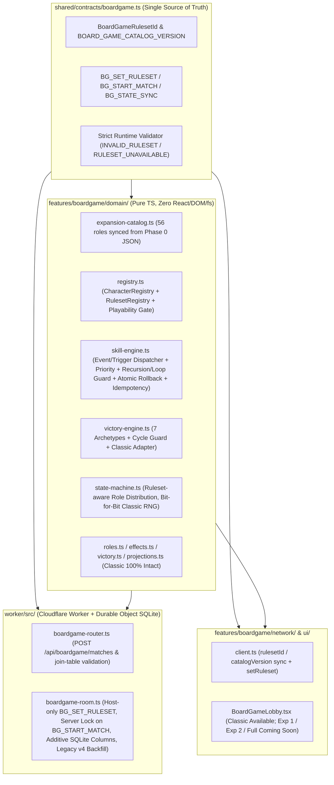

# Bóng Đêm KTX — Phase 1 Architecture Design (Expansion Foundation)

> **Phạm vi Phase 1:** Xây dựng kiến trúc nền tảng mở rộng nhân vật từ 10 Classic lên 66 tướng mà **không thay đổi bất kỳ hành vi gameplay, sát thương, điều kiện thắng hay RNG nào của bản Classic**, và **không kích hoạt bất kỳ nhân vật mở rộng nào vào production gameplay**.

---

## 1. Sơ đồ Kiến trúc Phân lớp (Layered Expansion Architecture)



---

## 2. Phân tách Trách nhiệm 5 Lớp trong `CharacterRegistry`

Mỗi nhân vật trong `features/boardgame/domain/registry.ts` được tách minh bạch thành 5 lớp độc lập (tránh coupling như bản Classic cũ):

| Lớp | TypeScript Interface | Chịu trách nhiệm | Classic (10 tướng) | Expansion (56 tướng) |
|---|---|---|---|---|
| **1. Character Metadata** | `CharacterMetadata` | `id`, `sourceName`, `expansionId`, `faction`, `sourceFaction`, `maxHp`, `sourceUrl`, `rulesStatus`, `implementationStatus`, `complexity`, `implementationDifficulty` | Đủ 10 (`verified` + `implemented`) | Đủ 56 (4 `verified`, 52 `needs-clarification`; tất cả `not-started`) |
| **2. Skill Specification** | `SkillDefinition` | Đặc tả phi thực thi: `skillId`, `name`, `description`, `trigger`, `usageLimit`, `revealRequirement`, `targetMode`, `cooldownRounds`, `oncePerMatch` | Đủ 10 | Đủ 56 |
| **3. Executable Skill Implementation** | `ExecutableSkillBinding \| null` | Liên kết handler thực thi được đăng ký & kiểm thử | Adapter nối `effects.ts` (`CLASSIC_SKILL_ADAPTER_BINDINGS`) | **`null`** (tuyệt đối không thực thi) |
| **4. Victory Spec & Implementation** | `VictoryConditionDefinition` + `ExecutableVictoryBinding \| null` | Đặc tả 7 archetype (`faction`, `individual`, `shared`, `conditional`, `dynamic-allegiance`, `copied-victory`, `simultaneous-victory`) & liên kết evaluator | Adapter nối `victory.ts` (`CLASSIC_VICTORY_DEFINITIONS`) | **`victoryImpl: null`** |
| **5. UI Presentation Metadata** | `CharacterUiPresentation` | `displayName`, `title`, `secretGoalText`, `portraitKey` | Đủ 10 | Metadata gốc phục vụ Phase 5 art/lore |

---

## 3. Cổng An toàn Đưa vào Pool Chơi (Hard Playability Gate)

Hàm `isCharacterPlayable(entry)` trong `features/boardgame/domain/registry.ts` áp dụng bất biến cứng:

```ts
export function isCharacterPlayable(entry: CharacterRegistryEntry): boolean {
  return (
    entry.availability === 'available' &&
    entry.metadata.rulesStatus === 'verified' &&
    entry.metadata.implementationStatus === 'implemented' &&
    entry.skillImpl !== null &&
    entry.victoryImpl !== null
  );
}
```

Kết hợp cùng `RulesetRegistry.validateRulesetForMatch(rawRulesetId, playerCount)`:
1. Từ chối `rawRulesetId` không hợp lệ bằng mã lỗi `INVALID_RULESET`.
2. Từ chối ruleset có `enabledInProduction === false` hoặc `availability !== 'available'` bằng mã lỗi `RULESET_UNAVAILABLE`.
3. Từ chối ruleset nếu tổng số nhân vật đăng ký nhỏ hơn `expectedCharacterCount`.
4. Từ chối ruleset nếu **bất kỳ** nhân vật nào trong ruleset chưa thỏa `isCharacterPlayable()`.
5. Từ chối ruleset nếu pool theo từng phe không đủ số lượng tối thiểu cho `getRoleDistribution(playerCount)`.

---

## 4. Phân vai Deterministic & Bảo toàn 100% RNG Classic

Trong `features/boardgame/domain/state-machine.ts`:
- `createInitialGameState` xác thực ruleset qua `DEFAULT_RULESET_REGISTRY.resolvePlayableRolePoolOrThrow(requestedRulesetId, orderedInputs.length)` (ném `BoardGameRulesetError` nếu sai hoặc chưa mở khóa).
- Với `rulesetId = 'classic'`, danh sách ứng viên 3 phe trả về **đúng thứ tự ban đầu** của `ROLES_CATALOG`:
  - `lanternGuard`: `['gac-ky-thuat', 'gac-truc-ban', 'gac-radio']`
  - `mistOrder`: `['suong-an-danh', 'suong-tin-gia', 'suong-gac-cong']`
  - `wanderer`: `['lang-anh-san', 'lang-quan-sat', 'lang-cuu-ho', 'lang-tien-phong']`
- Chuỗi gọi `shuffleWithRng` (Mulberry32) giữ nguyên **chính xác 9 bước**: Hunter -> Shadow -> Wanderer -> PickedRoleIds -> `investigation` -> `equipment` -> `event` -> `clusterPairs` -> `startingLocations`.
- Kết quả chứng minh trùng khớp **bit-for-bit 25/25 tổ hợp (4–8P × 5 seeds)** với snapshot trước khi refactor (`ce3b8c7`).

---

## 5. Bảo mật Multiplayer & Tách bạch Công khai / Riêng tư (P0)

- **Server-Authoritative Lock:** Client không bao giờ có quyền gửi danh sách tướng tùy ý (`CLIENT_MSG_ALLOWED_KEYS` chỉ cho phép `rulesetId`, bác bỏ mọi key lạ như `customRoleIds`). Server xác thực `rulesetId` tại cả 3 điểm: `POST /api/boardgame/matches`, `BG_SET_RULESET` (chỉ Host, chỉ ở Lobby), và `BG_START_MATCH` (khóa `rulesetId` + `catalogVersion` vào SQLite & `AuthoritativeGameState`).
- **Zero Private Leakage:** Chỉ `rulesetId` và `catalogVersion` (cấu hình phòng công khai) được thêm vào `BG_STATE_SYNC` và `BoardGamePublicGameView`. Vai trò ẩn, `hp`, `maxHp`, `privateClues`, `secretGoalText` tiếp tục nằm hoàn toàn trong kênh unicast `privateView` (và luôn `null` với Spectator).
