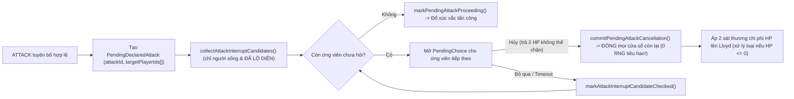

# Đặc tả `GlobalAttackInterrupt` (Phase 7A — Lloyd Pre-Roll Interrupt)

> **Module Chính:** [`features/boardgame/domain/global-attack-interrupt.ts`](../../../features/boardgame/domain/global-attack-interrupt.ts)  
> **Đối tượng Phục vụ:** `exp1_lloyd` (Lloyd — 12 HP) và mọi người chơi sao chép kỹ năng Lloyd qua `DynamicSkillCopy`.

---

## 1. Vòng đời Cửa sổ Ngắt Trước Xúc xắc (Pre-Roll Hook)

---

## 2. Yêu cầu Bất biến & An toàn

1. **Phạm vi Toàn bàn (Cross-Map):** Không yêu cầu Lloyd đứng cùng khu vực hay cùng cụm với kẻ tấn công hoặc nạn nhân.
2. **Đòn Súng Máy (Machine Gun `ev-06`) Là 1 Hành động Duy nhất:** `PendingDeclaredAttack.targetPlayerIds` chụp toàn bộ mục tiêu trong tầm trước khi mở cửa sổ ngắt; 1 lần trả 2 HP hủy sạch toàn bộ đòn đánh nhiều mục tiêu đó.
3. **Không tiêu hao RNG khi bị hủy:** `commitPendingAttackCancellation` dừng đường ống trước khi gọi `rollD6`/`rollD4` — `state.rngState` trước và sau cú hủy đòn bằng nhau tuyệt đối (ngoại trừ các hiệu ứng hậu tử vong độc lập nếu Lloyd chết vì chi phí 2 HP).
4. **Thứ tự Xác định & Chống Lặp Đa Ứng viên:**
   - Sắp xếp ứng viên theo `(seatDistanceFromActive ASC, playerId ASC)`.
   - `checkedCandidateIds` ghi lại từng ứng viên đã hỏi -> không bao giờ tạo vòng lặp vô hạn.
   - Ngay khi ứng viên đầu tiên xác nhận hủy (`status = 'CANCELLED'`), `collectAttackInterruptCandidates` trả về `[]` -> đóng ngay lập tức cửa sổ của mọi ứng viên còn lại.
5. **Không hồi tố sát thương đã cam kết:** Sau khi chuyển sang `status = 'PROCEED'`, `isPendingAttackCancellable` trả về `false` vĩnh viễn.
6. **Kiểm toán Tín hiệu Thời gian & `SET_REACTION_PREF`:**
   - Do luật thử nghiệm yêu cầu Lloyd phải **đã lộ diện** mới mở cửa sổ ngắt (`!player.revealed` bị loại ngay từ `collectAttackInterruptCandidates`), **không tồn tại side-channel làm lộ vai Lloyd khi đang ẩn**.
   - Khi Lloyd đã lộ diện, chính sách `SET_REACTION_PREF` của người chơi vẫn được tôn trọng: `AUTO_DECLINE` tự bỏ qua cửa sổ ngắt mà không làm chậm ván đấu; mặc định `ASK` mở cửa sổ có timeout an toàn (quá hạn = bỏ qua, không treo bàn).
