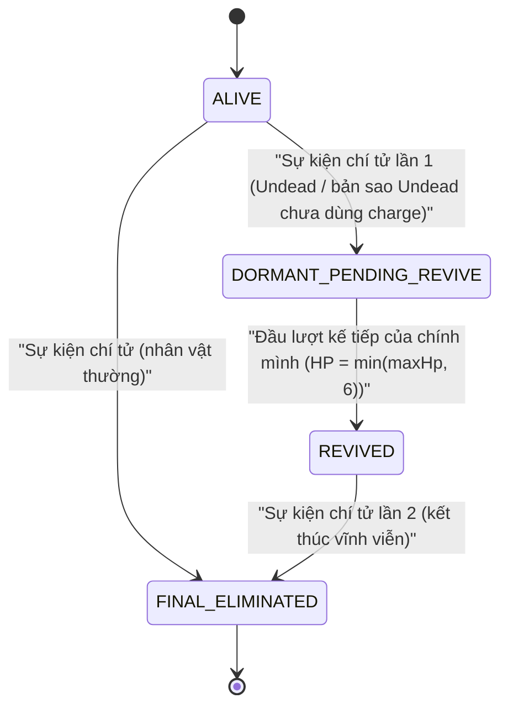

# Kiến trúc `PendingResurrection` & Thứ tự Giao dịch Loại 10 Bước (Phase 7A)

> **Module Chính:** [`features/boardgame/domain/pending-resurrection.ts`](../../../features/boardgame/domain/pending-resurrection.ts)  
> **Điểm tích hợp:** [`actions.ts`](../../../features/boardgame/domain/actions.ts), [`victory-engine.ts`](../../../features/boardgame/domain/victory-engine.ts), [`projections.ts`](../../../features/boardgame/domain/projections.ts), [`skill-engine.ts`](../../../features/boardgame/domain/skill-engine.ts)

---

## 1. Máy Trạng thái Vòng đời Người chơi (`PlayerLifecycleState`)

### Quy ước Bất biến từng Trạng thái

| Trạng thái | `player.alive` | Được phép hành động? | Có thể bị nhắm mục tiêu / nhận sát thương? | Tính là còn sống cho thắng phe? | Tính vào `deadCount` / death trigger / loot? | Được `advanceTurn` dừng tới lượt? |
|---|---|---|---|---|---|---|
| `ALIVE` | `true` | Có | Có | **Có** | Không | Có |
| `DORMANT_PENDING_REVIVE` | `false` | **Không** | **Không** | **Có** (`isPlayerLivingOrPendingRevive`) | **Không** (`isPlayerFinallyEliminated = false`) | **Có** (`isPlayerTurnEligible = true`) |
| `REVIVED` | `true` | Có | Có | **Có** | Không | Có |
| `FINAL_ELIMINATED` | `false` | Không | Không | **Không** | **Có** | Không |

---

## 2. Thứ tự Giao dịch Loại 10 Bước (`ELIMINATION_TRANSACTION_STAGES`)

Trong chế độ mở rộng, mọi sự kiện sát thương có thể dẫn tới loại người chơi tuân thủ nghiêm ngặt thứ tự 10 bước nhân quả với khóa chống phát lại theo `eventId`:

1. **`1_DAMAGE_APPLICATION`** — Áp sát thương gốc, chuyển hướng Anathema Stage 0, kiểm tra khiên/trang bị giảm sát thương.
2. **`2_DEFENSIVE_REACTIONS_AND_PREVENTION`** — Phản ứng phòng thủ (`G43`, `Bianca`, `Urban Legend`, `Undying`, `Arnold` phản đòn chí tử).
3. **`3_LETHAL_STATE_CLASSIFICATION`** — Xác định `target.hp <= 0`.
4. **`4_PENDING_RESURRECTION_CHECK`** — Kiểm tra `canPlayerEnterPendingResurrection(state, target)`. Nếu đạt (Undead hoặc bản sao Undead chưa dùng charge):
   - Gọi `enterDormantPendingRevive(state, target, eventId, nowMs, 6)` (nguyên tử & idempotent theo `dormantEventId`).
   - Lật vai công khai, giữ nguyên trang bị đang đeo, **DỪNG** chuỗi loại tại đây (không sang bước 5–8; không kích hoạt thắng phe Hunter nếu là Shadow cuối!).
5. **`5_COMMITTED_ELIMINATION`** — Gọi `commitFinalEliminationLifecycle` (`FINAL_ELIMINATED`), ghi `firstDeadPlayerId` (nếu là người chết vĩnh viễn đầu tiên), `eliminatedRound`, `eliminatedByPlayerId`, ghi nhận `killedFactionsByPlayer` (phục vụ Cain 5P), phát `AuthoritativeRoleRevealRecord` (`isDeathReveal: true`), hủy mọi `TurnControlGrant` liên quan.
6. **`6_ON_ELIMINATION_SKILL_TRIGGERS`** — Kích hoạt `Daniel` (Scream), `Charles` (Bloody Feast), `Arlene`, `Cruz`, `Dalton`, `Wyvern`, `Vengeance`, `Wendigo`, `Gideon`, và **chuyển phe động của `Bonnie`** (trước bước đánh giá thắng thua!).
7. **`7_COPY_AND_AFFILIATION_HOOKS`** — `Antimony` (tự động bắt buộc ở lần loại vĩnh viễn đầu tiên) và `Vengeful Spirit` (cửa sổ chọn sao chép kỹ năng tùy chọn).
8. **`8_EQUIPMENT_LOOT_AND_CLEANUP`** — Thực thi giao dịch cướp/thu hồi trang bị nguyên tử (`executeEquipmentTransferTransaction`) và hủy trang bị còn lại.
9. **`9_VICTORY_CANDIDATE_COLLECTION`** — Thu thập đồng thời ứng viên thắng phe (tính `DynamicAllegiance` + `DORMANT_PENDING_REVIVE` + `Cain` song phe), thắng độc hành, Liên minh N.C. Soldier và `CopiedVictoryGraph`.
10. **`10_FINAL_VICTORY_RESOLUTION`** — Hợp nhất tất định danh sách người thắng theo `turnOrder`, gán `winnerFaction` + `winningFactions`, dựng `finalReveal`.

---

## 3. Khôi phục qua Durable Object Hibernation & Bảo vệ Chống Hồi sinh Kép

- Toàn bộ `lifecycleByPlayer[playerId]` là JSON thuần trong `AuthoritativeGameState.expansionState`, tự động lưu vào SQLite `game_state_json` của `BoardGameRoom`.
- Sau khi `reviveDormantPlayerAtTurnStart` hoàn tất:
  - `resurrectionChargesUsed` tăng lên `1` và `skillUsedOnce = true` (trên `player` cho Undead gốc, hoặc trên `CopiedSkillBinding` cho bản sao Undead).
  - `canPlayerEnterPendingResurrection` luôn trả `false` ở lần chí tử thứ hai -> chắc chắn kết thúc bằng `FINAL_ELIMINATED`.
- Classic (`rulesetId === 'classic'`) không bao giờ tạo `lifecycleByPlayer` và giữ nguyên 100% logic `victory.ts` / `effects.ts`.
