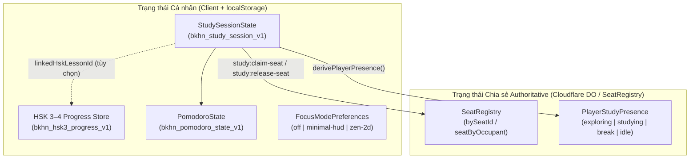
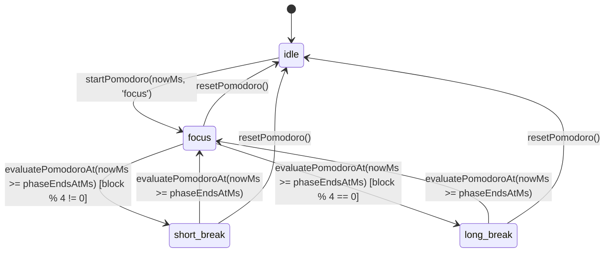

# Đặc tả Kỹ thuật: Pomodoro Timer, Study Session, Focus Mode & Study Rooms (`PR6`)

## 1. Thông tin Định danh Module

- **Module IDs:**
  - `feature.study.pomodoro` — Đồng hồ Pomodoro dựa trên mốc thời gian thực (`wall-clock epoch`).
  - `feature.study.session` — Phiên tự học cá nhân, danh sách việc cần làm (`StudyTaskItem`), lịch sử phiên học và liên kết tùy chọn với bài học HSK 3–4.
  - `feature.study.focus-mode` — Chế độ tập trung (`off`, `minimal-hud`, `zen-2d` tắt hoàn toàn WebGL 3D).
  - `feature.social.study-rooms` — Phòng tự học chung & quản lý chỗ ngồi (`SeatOccupancy`) có tính quyết định từ server (`authoritative`).
  - `feature.social.presence` — Trạng thái hiện diện học tập (`PlayerStudyPresence`) phát quảng bá trong phòng.
- **Source Paths:**
  - Hợp đồng chia sẻ (Frontend + Cloudflare Worker): [`shared/contracts/study.ts`](file:///home/bao/Hust3D/hust-hsk/shared/contracts/study.ts)
  - Đồng hồ Pomodoro thuần: [`features/study/pomodoro/timer.ts`](file:///home/bao/Hust3D/hust-hsk/features/study/pomodoro/timer.ts)
  - Phiên tự học cá nhân: [`features/study/study-session/session.ts`](file:///home/bao/Hust3D/hust-hsk/features/study/study-session/session.ts)
  - Chính sách Focus Mode: [`features/study/focus-mode/focus-mode.ts`](file:///home/bao/Hust3D/hust-hsk/features/study/focus-mode/focus-mode.ts)
  - Quản lý ghế ngồi Study Room: [`features/social/rooms/seat-manager.ts`](file:///home/bao/Hust3D/hust-hsk/features/social/rooms/seat-manager.ts)
  - Trạng thái hiện diện: [`features/social/presence/presence.ts`](file:///home/bao/Hust3D/hust-hsk/features/social/presence/presence.ts)
  - Kiểm thử đơn vị: [`test/study-social-contracts.test.cjs`](file:///home/bao/Hust3D/hust-hsk/test/study-social-contracts.test.cjs)
- **Current Implementation Status:** **Implemented (`PR6` — Contracts, Pure State Machines & Architecture Verified)**

---

## 2. Phân tách Ranh giới Trạng thái: Cá nhân (`Session State`) vs. Chia sẻ (`Room State`)

| Thuộc tính | Nơi Lưu trữ Authoritative | Có Gửi Qua WebSocket? | Ghi chú |
|---|---|---|---|
| Điểm HSK, SRS, Sổ lỗi, Chuỗi ngày | `localStorage` (`bkhn_hsk3_progress_v1`) | **Không** | Thuộc module độc lập `feature.learning.hsk` (`lib/learn/store.ts`). |
| Danh sách mục tiêu cá nhân (`tasks`), lịch sử `CompletedFocusBlock` | `localStorage` (`bkhn_study_session_v1`) | **Không** | Riêng tư trên thiết bị của người học. |
| Mốc thời gian Pomodoro cá nhân (`phaseStartedAtMs`, `phaseEndsAtMs`) | `localStorage` (`bkhn_pomodoro_state_v1`) | Chỉ gửi nhãn `pomodoroPhase` | Phục hồi chính xác sau khi F5 hoặc ẩn tab. |
| Chiếm giữ chỗ ngồi (`SeatOccupancy`: `seatId`, `occupantId`) | Server / Durable Object (`SeatRegistry`) | **Có** (`study:seat-claimed`, `study:seat-released`) | Mỗi sinh viên chỉ giữ tối đa 1 ghế tại một thời điểm; tự giải phóng khi ngắt kết nối. |
| Trạng thái hiện diện (`PlayerStudyPresence`) | Server / Durable Object | **Có** (`study:presence`) | Chỉ chứa `status`, `studyRoomId`, `seatId`, `pomodoroPhase`, `subjectTag` (tối đa 36 ký tự). |

---

## 3. Máy trạng thái Đồng hồ Pomodoro (`feature.study.pomodoro`)

### Bất biến Kỹ thuật (Invariants)
1. **Không phụ thuộc `setInterval` hay `useFrame`:**
   - Thời gian còn lại luôn được tính bằng công thức `Math.max(0, state.phaseEndsAtMs - nowMs)` (khi `running === true`) hoặc `state.pausedRemainingMs` (khi `running === false`).
   - Khi trình duyệt làm chậm timer ở background tab hoặc người dùng F5 tải lại trang sau nhiều phút, [`evaluatePomodoroAt`](file:///home/bao/Hust3D/hust-hsk/features/study/pomodoro/timer.ts#L172-L273) và [`deserializePomodoroState`](file:///home/bao/Hust3D/hust-hsk/features/study/pomodoro/timer.ts#L285-L353) tự động tính bù chính xác số chu kỳ đã qua và cộng đủ `completedFocusBlocks` cũng như `totalFocusedMs`.
2. **Chạy độc lập với 3D Rendering (`Focus Mode: zen-2d`):**
   - Khi người học chọn `level: 'zen-2d'`, [`computeFocusRuntimePolicy`](file:///home/bao/Hust3D/hust-hsk/features/study/focus-mode/focus-mode.ts#L78-L114) trả về `suspend3DRendering: true` và `allowLearningAndPomodoro: true`, cho phép tắt hoàn toàn Canvas 3D để tiết kiệm pin trong khi đồng hồ Pomodoro và Sổ tay HSK vẫn hoạt động bình thường.

---

## 4. Danh mục Khu vực Tự học & Chỗ ngồi Chuẩn (`STUDY_ROOMS` & `STUDY_SEATS`)

1. **`library-lobby`** — *Sảnh Tầng 1 Thư viện Tạ Quang Bửu* (`quietLevel: 'whisper'`, 4 ghế mẫu `tqb-1f-t1-s1..t2-s2`).
2. **`library-reading-3f`** — *Phòng đọc Tự học Tầng 3 Thư viện Tạ Quang Bửu* (`quietLevel: 'silent'`, 4 ghế mẫu `tqb-3f-t1-s1..t2-s2`).
3. **`c1-classroom-101`** — *Phòng học C1-101 Tòa nhà C1* (`quietLevel: 'collaborative'`, 4 ghế mẫu `c1-101-d1-s1..d2-s2`).
4. **`tien-lake-pavilion`** — *Bàn đá ven Hồ Tiền (C9 – Cầu thang đỏ)* (`quietLevel: 'collaborative'`, 2 ghế mẫu `lake-bench-w1`, `lake-bench-n1`).
