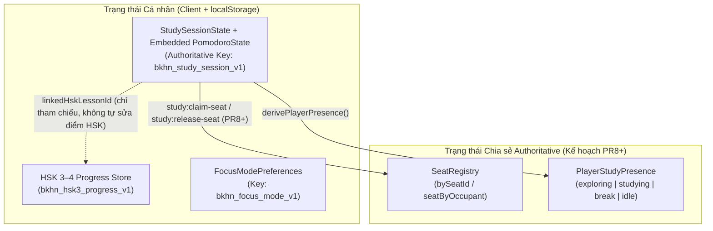
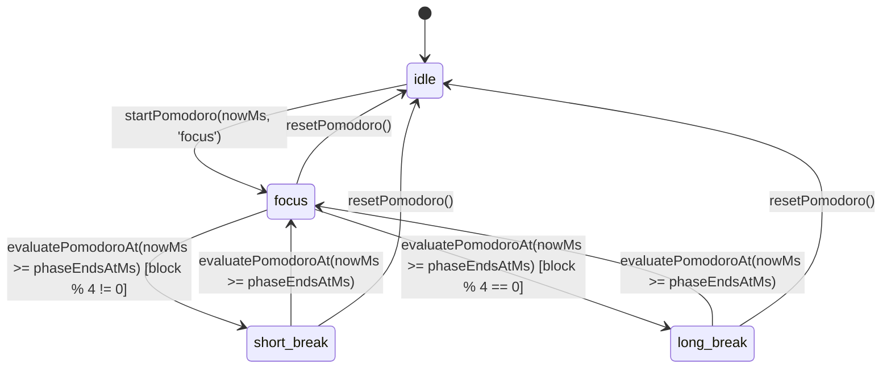

# Đặc tả Kỹ thuật: Pomodoro Timer, Study Session, Focus Mode & Study Rooms (`PR6` & `PR7`)

## 1. Thông tin Định danh Module & Trạng thái Thực thi

- **Module IDs:**
  - `feature.study.pomodoro` — Đồng hồ Pomodoro dựa trên mốc thời gian thực (`wall-clock epoch`) cùng giao diện điều khiển React.
  - `feature.study.session` — Phiên tự học cá nhân, danh sách việc cần làm (`StudyTaskItem`), lịch sử phiên học (`CompletedFocusBlock`) và liên kết tham khảo bài học HSK 3–4 (`linkedHskLessonId`).
  - `feature.study.focus-mode` — Chế độ tập trung (`off`, `minimal-hud`, `zen-2d` tạm dừng hoàn toàn WebGL 3D).
  - `feature.social.study-rooms` — Hợp đồng dữ liệu phòng tự học chung & bộ quản lý chỗ ngồi (`SeatOccupancy`) có tính quyết định từ server (`authoritative`).
  - `feature.social.presence` — Hợp đồng trạng thái hiện diện học tập (`PlayerStudyPresence`).
- **Source Paths:**
  - Hợp đồng chia sẻ (Frontend + Cloudflare Worker): [`shared/contracts/study.ts`](../../shared/contracts/study.ts)
  - Đồng hồ Pomodoro thuần & React Hook/UI:
    - [`features/study/pomodoro/timer.ts`](../../features/study/pomodoro/timer.ts)
    - [`features/study/pomodoro/usePomodoro.ts`](../../features/study/pomodoro/usePomodoro.ts)
    - [`features/study/pomodoro/PomodoroTimer.tsx`](../../features/study/pomodoro/PomodoroTimer.tsx)
  - Phiên tự học cá nhân & Danh sách việc cần làm:
    - [`features/study/study-session/session.ts`](../../features/study/study-session/session.ts)
    - [`features/study/study-session/useStudySession.ts`](../../features/study/study-session/useStudySession.ts)
    - [`features/study/study-session/StudyTaskList.tsx`](../../features/study/study-session/StudyTaskList.tsx)
  - Chính sách Focus Mode & Giao diện Zen 2D:
    - [`features/study/focus-mode/focus-mode.ts`](../../features/study/focus-mode/focus-mode.ts)
    - [`features/study/focus-mode/FocusModeView.tsx`](../../features/study/focus-mode/FocusModeView.tsx)
  - Bảng Tự học & Thống kê Phiên học:
    - [`features/study/ui/StudyPanel.tsx`](../../features/study/ui/StudyPanel.tsx)
    - [`features/study/ui/StudySessionSummary.tsx`](../../features/study/ui/StudySessionSummary.tsx)
  - Quản lý ghế ngồi & Trạng thái hiện diện (chuẩn bị cho `PR8`):
    - [`features/social/rooms/seat-manager.ts`](../../features/social/rooms/seat-manager.ts)
    - [`features/social/presence/presence.ts`](../../features/social/presence/presence.ts)
  - Kiểm thử Đơn vị & Smoke Test Trình duyệt:
    - [`test/study-social-contracts.test.cjs`](../../test/study-social-contracts.test.cjs)
    - [`test/study-mvp-smoke.cjs`](../../test/study-mvp-smoke.cjs)

### Phân loại Trạng thái Triển khai (`PR6` vs `PR7` vs `PR8+`)

| Hạng mục | Trạng thái | Kiểm thử Đã Chạy |
|---|---|---|
| **Hợp đồng `shared/contracts/study.ts` & State Machine thuần (`PR6`)** | **Đã triển khai & kiểm thử** | `npm run test:study` (`12/12` unit/integration tests PASS) |
| **Giao diện Tự học (`StudyPanel`), Đồng hồ Pomodoro (`25/5` & `50/10`), Danh sách việc cần làm (`StudyTaskList`), Thống kê (`StudySessionSummary`) & 29 mã bài HSK chuẩn (`PR7`)** | **Đã triển khai & kiểm thử trình duyệt** | `npm run test:study` (`12/12` PASS) + Playwright `node test/study-mvp-smoke.cjs` (`9/9` bước PASS) |
| **Lưu trữ Authoritative đơn nguồn (`bkhn_study_session_v1`), Cô lập tick hiển thị khỏi `HomePage`/`localStorage` & Chống đếm/thông báo trùng phiên Focus qua F5 / ẩn tab / React Strict Mode (`PR7`)** | **Đã triển khai & kiểm thử trình duyệt** | `npm run test:study` (`12/12` PASS) + Playwright `node test/study-mvp-smoke.cjs` |
| **Focus Mode (`off` Normal 3D, `minimal-hud`, `zen-2d` tắt WebGL & bảo toàn tọa độ nhân vật khi quay lại 3D) (`PR7`)** | **Đã triển khai & kiểm thử trình duyệt** | `npm run test:study` (`12/12` PASS) + Playwright `node test/study-mvp-smoke.cjs` |
| **Đặt chỗ ngồi thời gian thực qua WebSocket (`study:claim-seat`), phát quảng bá `study:presence` từ Cloudflare Worker và hoạt cảnh ngồi ghế 3D (`PR8+`)** | **Lên kế hoạch cho `PR8+`** (Đã có state machine & unit test tại `seat-manager.ts`, chưa nối vào luồng WebSocket/UI) | Unit test logic tại `test/study-social-contracts.test.cjs` |

---

## 2. Kiến trúc Lưu trữ Đơn nguồn (Single Authoritative Persistence) & Ranh giới Trạng thái

### Quyết định Lưu trữ Authoritative (`PR7`)
1. **Một khóa `localStorage` duy nhất cho Phiên học & Đồng hồ Pomodoro (`bkhn_study_session_v1`):**
   - Toàn bộ trạng thái `StudySessionState` (bao gồm `pomodoro: PomodoroState`, `tasks: StudyTaskItem[]`, `history: CompletedFocusBlock[]`, `subjectTag`, `linkedHskLessonId`) được đọc/ghi tập trung qua `loadStudySession` và `saveStudySession` tại [`features/study/study-session/session.ts`](../../features/study/study-session/session.ts).
   - Không ghi song song vào hai khóa đồng hồ độc lập để loại bỏ hoàn toàn nguy cơ lệch pha giữa `POMODORO_STORAGE_KEY` và `STUDY_SESSION_STORAGE_KEY`. Nếu phát hiện dữ liệu cũ ở `POMODORO_STORAGE_KEY` khi chưa có `STUDY_SESSION_STORAGE_KEY`, `loadStudySession` tự động di trú một lần sang `bkhn_study_session_v1`.
2. **Đảm bảo mỗi phiên Focus hoàn thành chỉ được ghi nhận đúng 1 lần (`Idempotent Completion Recording`):**
   - Hàm `syncStudySessionAt(session, nowMs)` đối chiếu mốc thời gian thực `nowMs` qua `evaluatePomodoroAt` và ghi nhận từng cửa sổ `CompletedFocusWindow` vào `session.history` qua `recordFocusBlockCompletion`.
   - `recordFocusBlockCompletion` kiểm tra trùng lặp theo mốc kết thúc `endedAtMs` (`id: focus-${endedAtMs}`), đảm bảo dù người dùng F5 tải lại trang, chuyển tab nền, hay React chạy lại effect trong StrictMode thì mỗi phiên Focus hoàn tất chỉ được tính **đúng 1 lần**.
3. **Cô lập tuyệt đối với Tiến độ HSK (`bkhn_hsk3_progress_v1`):**
   - Hoàn thành phiên Pomodoro không tự động thay đổi điểm số, chuỗi ngày học (streak), trạng thái nhiệm vụ hay lịch ôn SRS của phân hệ HSK.

---

## 3. Máy trạng thái Đồng hồ Pomodoro (`feature.study.pomodoro`)

### Các Nhịp Pomodoro Hỗ trợ (`PR7`)
- **Mặc định (`25-5`):** 25 phút Tập trung (`focus`) / 5 phút Nghỉ ngắn (`short-break`) / 15 phút Nghỉ dài (`long-break` sau mỗi 4 phiên Focus).
- **Tùy chọn (`50-10`):** 50 phút Tập trung (`focus`) / 10 phút Nghỉ ngắn (`short-break`) / 15 phút Nghỉ dài (`long-break` sau mỗi 4 phiên Focus).
- **Thao tác hỗ trợ:** Bắt đầu (`Start`), Tạm dừng (`Pause`), Tiếp tục (`Resume`), Chuyển pha (`Skip phase`), Đặt lại (`Reset`).

---

## 4. Ba Cấp độ Focus Mode (`feature.study.focus-mode`)

1. **`off` (Normal 3D):**
   - Giữ nguyên khung cảnh 3D Bách khoa và toàn bộ nút điều khiển trên `CampusHud`.
2. **`minimal-hud` (Minimal HUD):**
   - Giữ khung cảnh 3D nhưng ẩn Bản đồ nhỏ (`Minimap`), nút Đi nhanh, Gọi xe, Đổi giờ/trang phục và bảng hướng dẫn để giảm xao nhãng khi đang trong pha `focus`.
   - Luôn hiển thị nút **`🎯 Đang bật Minimal HUD · Thoát Focus Mode`** và nút **`🍅 Tự học · MM:SS`** để người học kiểm soát phiên hoặc quay về HUD đầy đủ bất kỳ lúc nào.
3. **`zen-2d` (Zen 2D — Tạm dừng 3D WebGL):**
   - Tạm dừng hoàn toàn `<CampusScene />` (`suspend3DRendering: true`) và hiển thị giao diện bàn học 2D nhẹ (`FocusModeView.tsx`).
   - Giữ nguyên kết nối Multiplayer (`useMultiplayerBridge` vẫn hoạt động ở `app/page.tsx`) và bảo toàn nguyên vẹn tọa độ `playerState.pos`, góc nhìn `cameraYaw`/`cameraPitch`, hướng mặt `facing` khi bấm **`🏞️ Quay lại khuôn viên 3D`**.
