# Lộ trình Phát triển & Tái cấu trúc (`Roadmap`)

## 1. Các Giai đoạn Nền tảng Đã Hoàn thành (Đợt 1 – Đợt 8)

| Giai đoạn | Hạng mục Chính | Trạng thái |
|---|---|---|
| **Bước 0–3** | Khởi tạo dự án, kiểm toán nội dung HSK 3–4, dựng blockout 3D và các công trình biểu tượng (Cổng Parabol, Nhà C1, Thư viện Tạ Quang Bửu, Hồ Tiền, Nhà C9). | Hoàn thành |
| **Bước 4–5** | Xây dựng Engine học HSK & SRS (`lib/learn/*`), phát âm TTS (`speech.ts`), Phòng học mô phỏng C1 và tuyến nhiệm vụ đầu tiên `"Buổi học đầu tiên"`. | Hoàn thành |
| **Bước 6–7** | Mở rộng đầy đủ 246 từ HSK 3 (bài 10–18, 10 quest) và 811 từ HSK 4 (bài 1–20, 40 quest), nâng tổng số lên **1.057 từ / 29 bài / 50 nhiệm vụ**. | Hoàn thành |
| **Bước 8** | Lịch ôn SRS 7 ngày, phiên ôn tập nhanh Flashcard, Sổ lỗi theo bài, 6 Huy hiệu toàn cục, chuỗi ngày học liên tiếp (Streak) và Xuất/Nhập JSON. | Hoàn thành |
| **Đợt 3–4** | Hệ thống xe máy cá nhân (`Motorbike`), Dịch chuyển nhanh 6 điểm (`Fast Travel`), xoay chuẩn hướng Bắc mặt đồng hồ Thư viện và dựng tiền cảnh chữ `HUST`. | Hoàn thành |
| **Đợt 5** | Multiplayer thời gian thực qua Cloudflare Worker + Durable Object (`hust-hsk-rooms`, 5 phòng × 15 người). | Hoàn thành |
| **Đợt 6–8** | Mở rộng toàn khuôn viên theo bản đồ thật (`C2`, `C3–C10`, `C6–C8`, `D2–D9`, `B1 SoICT`, `KTX B3–B13`, `SVĐ`, Cổng Trần Đại Nghĩa & tường rào khuôn viên), dựng Sảnh tầng 1 Thư viện (`LibraryLobby`), chu kỳ Ngày/Hoàng hôn/Đêm, và hệ thống nhân vật Nam/Nữ với 10 bộ đồng phục HUST đồng bộ qua Multiplayer. | Hoàn thành |

---

## 2. Lộ trình Kiến trúc Modular Monolith & Sản phẩm Tự học (`PR1` – `PR9`)

```mermaid
flowchart LR
  PR1["PR1: Shared Contracts & Safety"] --> PR2["PR2: Documentation Architecture"]
  PR2 --> PR3["PR3: Campus World Data Refactor"]
  PR3 --> PR4["PR4: 3D Components Modularization"]
  PR4 --> PR5["PR5: App UI & Gameplay Separation"]
  PR5 --> PR6["PR6: Study & Social Contracts"]
  PR6 --> PR7["PR7: Study Experience MVP"]
  PR7 --> PR8["PR8: Interactive 3D Library Seating"]
  PR8 --> PR9["PR9: Authoritative Multiplayer Seating"]
```

### A. Đã Triển khai & Kiểm thử (`PR1` – `PR8`)

1. **`PR1 — Foundation, Safety & Shared Contracts` (Đã hoàn thành):**
   - Hợp nhất biên thế giới `BOUNDS` và hằng số không gian tại [`shared/constants/world.ts`](../../shared/constants/world.ts).
   - Hợp nhất kiểu dữ liệu, bộ lọc hợp lệ và giao thức WebSocket tại [`shared/contracts/multiplayer.ts`](../../shared/contracts/multiplayer.ts).
   - Khắc phục lỗi mất phiên khi Cloudflare Durable Object thức dậy sau Hibernation trong [`worker/src/room.ts`](../../worker/src/room.ts).
   - Thiết lập CI workflow (`.github/workflows/ci.yml`) và bộ unit test [`test/shared-contracts.test.cjs`](../../test/shared-contracts.test.cjs).

2. **`PR2 — Documentation Architecture` (Đã hoàn thành):**
   - Thiết lập kiến trúc tài liệu chuẩn hóa dưới `docs/` (`product/`, `architecture/`, `world/`, `features/`, `adr/`, `testing/`, `status/`).
   - Định danh Module IDs (`building.*`, `landmark.*`, `interior.*`, `avatar.*`, `feature.*`) kèm bất biến (invariants) và tiêu chí nghiệm thu.

3. **`PR3 — Campus World Data Refactoring` (Đã hoàn thành):**
   - Tách [`lib/campus.ts`](../../lib/campus.ts) thành các module dữ liệu thế giới tại `features/campus/world-data/` (`buildings`, `colliders`, `roads`, `zones`, `navigation`, `bounds`, `spatial-utils`) và giữ facade tương thích ngược tại `lib/campus.ts`.

4. **`PR4 — 3D Components Modularization` (Đã hoàn thành):**
   - Tách các file 3D lớn ([`components/three/CampusExpansion.tsx`](../../components/three/CampusExpansion.tsx), [`components/three/Landmarks.tsx`](../../components/three/Landmarks.tsx), [`components/three/StudentAvatar.tsx`](../../components/three/StudentAvatar.tsx)) theo từng công trình, landmark, rig, trang phục và chuyển động mà không làm thay đổi hình học hay hiệu năng.

5. **`PR5 — Application UI & Gameplay Separation` (Đã hoàn thành):**
   - Thu gọn [`app/page.tsx`](../../app/page.tsx) bằng cách tách các miền: `features/learning/hsk/`, `features/campus/ui/CampusHud.tsx`, `features/campus/interaction/`, và `features/social/multiplayer/MultiplayerStatusBar.tsx`.

6. **`PR6 — Study & Social Architecture Preparation` (Đã hoàn thành):**
   - Thiết kế hợp đồng dữ liệu [`shared/contracts/study.ts`](../../shared/contracts/study.ts), state machine thuần và tài liệu kỹ thuật cho `Study Room`, `Seat Occupancy` ([`features/social/rooms/seat-manager.ts`](../../features/social/rooms/seat-manager.ts)), `Study Session` ([`features/study/study-session/session.ts`](../../features/study/study-session/session.ts)), `Pomodoro Timer` ([`features/study/pomodoro/timer.ts`](../../features/study/pomodoro/timer.ts)), `Focus Mode` ([`features/study/focus-mode/focus-mode.ts`](../../features/study/focus-mode/focus-mode.ts)) và `Player Presence` ([`features/social/presence/presence.ts`](../../features/social/presence/presence.ts)).

7. **`PR7 — HUST-HSK Study Experience MVP` (Đã hoàn thành & Kiểm thử trình duyệt):**
   - Tích hợp nút **`🍅 Tự học`** vào [`features/campus/ui/CampusHud.tsx`](../../features/campus/ui/CampusHud.tsx) và bảng điều khiển [`features/study/ui/StudyPanel.tsx`](../../features/study/ui/StudyPanel.tsx).
   - Hỗ trợ đồng hồ Pomodoro wall-clock (`25/5` và `50/10`, Start, Pause, Resume, Skip phase, Reset), danh sách việc cần làm ([`StudyTaskList.tsx`](../../features/study/study-session/StudyTaskList.tsx)), thống kê phiên học ([`StudySessionSummary.tsx`](../../features/study/ui/StudySessionSummary.tsx)) và lưu trữ đơn nguồn tại `bkhn_study_session_v1`.
   - Tích hợp 3 chế độ Focus Mode (`Normal 3D`, `Minimal HUD`, `Zen 2D` qua [`FocusModeView.tsx`](../../features/study/focus-mode/FocusModeView.tsx)), bảo toàn vị trí nhân vật và kết nối Multiplayer khi chuyển qua lại giữa `Zen 2D` và `3D Campus`.
   - Kiểm chứng bằng unit test [`test/study-social-contracts.test.cjs`](../../test/study-social-contracts.test.cjs) (`12/12` PASS) và smoke test trình duyệt [`test/study-mvp-smoke.cjs`](../../test/study-mvp-smoke.cjs) (`9/9` bước PASS).

8. **`PR8 — Interactive 3D Library Seating & Study Experience` (Đã hoàn thành & Kiểm thử trình duyệt):**
   - Dựng khu bàn đọc tự học 3D tại Sảnh tầng 1 Thư viện Tạ Quang Bửu ([`features/campus/buildings/library/`](../../features/campus/buildings/library/index.ts): `LibraryStudyArea.tsx`, `StudyTable.tsx`, `StudyChair.tsx`, `StudySeatMarkers.tsx`) với 2 bàn đọc gỗ sồi + 4 ghế ngồi học (`tqb-1f-t1-s1..s2`, `tqb-1f-t2-s1..s2`) khớp chuẩn với `STUDY_SEATS` và `LIBRARY_LOBBY_COLLIDERS`.
   - Xây dựng máy trạng thái ngồi học cục bộ ([`features/campus/interaction/seat-interaction.ts`](../../features/campus/interaction/seat-interaction.ts)), kiểm tra khoảng cách tiếp cận (`SEAT_INTERACT_RADIUS = 1.65m`), tư thế ngồi học 3D (`computeSeatedPoseTargets`, `SEATED_GROUP_Y_OFFSET = -0.35m`), điểm đứng dậy an toàn không va chạm (`computeSafeStandUpPosition`), và tự động gắn `studyRoomId: 'library-lobby'` + `seatId` vào `StudySessionState`.
   - Kiểm chứng bằng unit test [`test/ui-gameplay.test.cjs`](../../test/ui-gameplay.test.cjs) (`7/7` PASS) và smoke test trình duyệt [`test/library-seating-smoke.cjs`](../../test/library-seating-smoke.cjs) (`14/14` bước PASS).

---

### B. Kế hoạch Cho Giai đoạn Tiếp theo (`PR9`)

- **`PR9 — Authoritative Multiplayer Seat Occupancy & Shared Study Presence` (Chưa triển khai trong `PR8`):**
  - Tích hợp `seat-manager.ts` và các bản tin `study:claim-seat`, `study:release-seat`, `study:presence`, `study:room-snapshot` vào Cloudflare Worker (`worker/src/room.ts`) và client `lib/multiplayer.ts`.
  - Đồng bộ trạng thái chiếm chỗ ghế thời gian thực giữa nhiều người chơi trong cùng phòng, hiển thị nhân vật người chơi khác ngồi tại ghế và huy hiệu trạng thái học tập (`🍅 Đang tự học · ...`) trên đỉnh đầu nhân vật, đồng thời mở rộng bàn ghế tương tác sang Phòng học C1 và Hồ Tiền.
