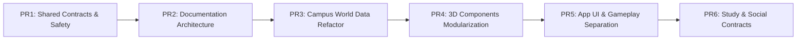

# Lộ trình Phát triển & Tái cấu trúc (`Roadmap`)

## 1. Các Giai đoạn Đã Hoàn thành (Đợt 1 – Đợt 8)

| Giai đoạn | Hạng mục Chính | Trạng thái |
|---|---|---|
| **Bước 0–3** | Khởi tạo dự án, kiểm toán nội dung HSK 3–4, dựng blockout 3D và các công trình biểu tượng (Cổng Parabol, Nhà C1, Thư viện Tạ Quang Bửu, Hồ Tiền, Nhà C9). | Hoàn thành |
| **Bước 4–5** | Xây dựng Engine học HSK & SRS (`lib/learn/*`), phát âm TTS (`speech.ts`), Phòng học mô phỏng C1 và tuyến nhiệm vụ đầu tiên `"Buổi học đầu tiên"`. | Hoàn thành |
| **Bước 6–7** | Mở rộng đầy đủ 246 từ HSK 3 (bài 10–18, 10 quest) và 811 từ HSK 4 (bài 1–20, 40 quest), nâng tổng số lên **1.057 từ / 29 bài / 50 nhiệm vụ**. | Hoàn thành |
| **Bước 8** | Lịch ôn SRS 7 ngày, phiên ôn tập nhanh Flashcard, Sổ lỗi theo bài, 6 Huy hiệu toàn cục, chuỗi ngày học liên tiếp (Streak) và Xuất/Nhập JSON. | Hoàn thành |
| **Đợt 3–4** | Hệ thống xe máy cá nhân (`Motorbike`), Dịch chuyển nhanh 6 điểm (`Fast Travel`), xoay chuẩn hướng Bắc mặt đồng hồ Thư viện và dựng tiền cảnh chữ `HUST`. | Hoàn thành |
| **Đợt 5** | Multiplayer thời gian thực qua Cloudflare Worker + Durable Object (`hust-hsk-rooms`, 5 phòng × 15 người). | Hoàn thành |
| **Đợt 6–8** | Mở rộng toàn khuôn viên theo bản đồ thật (`C2`, `C3–C10`, `C6–C8`, `D2–D9`, `B1 SoICT`, `KTX B3–B13`, `SVĐ`), dựng Sảnh tầng 1 Thư viện (`LibraryLobby`), chu kỳ Ngày/Hoàng hôn/Đêm, và hệ thống nhân vật Nam/Nữ với 10 bộ đồng phục HUST đồng bộ qua Multiplayer. | Hoàn thành |

---

## 2. Lộ trình Tái cấu trúc Modular Monolith (`PR1` – `PR6`)

Nhằm chuyển đổi codebase từ cấu trúc tập trung ban đầu sang kiến trúc **Modular Monolith** dễ bảo trì và sẵn sàng mở rộng thành **HUST Virtual Study Campus**, lộ trình kỹ thuật được chia thành 6 PR tuần tự:

### Chi tiết từng PR

1. **`PR1 — Foundation, Safety & Shared Contracts` (Đã hoàn thành):**
   - Hợp nhất biên thế giới `BOUNDS = { minX: -96, maxX: 168, minZ: -76, maxZ: 108 }` và hằng số không gian tại [`shared/constants/world.ts`](file:///home/bao/Hust3D/hust-hsk/shared/constants/world.ts).
   - Hợp nhất kiểu dữ liệu, bộ lọc hợp lệ và giao thức WebSocket tại [`shared/contracts/multiplayer.ts`](file:///home/bao/Hust3D/hust-hsk/shared/contracts/multiplayer.ts).
   - Khắc phục lỗi mất phiên khi Cloudflare Durable Object thức dậy sau Hibernation trong [`worker/src/room.ts`](file:///home/bao/Hust3D/hust-hsk/worker/src/room.ts).
   - Thiết lập CI workflow (`.github/workflows/ci.yml`) và bộ unit test [`test/shared-contracts.test.cjs`](file:///home/bao/Hust3D/hust-hsk/test/shared-contracts.test.cjs).

2. **`PR2 — Documentation Architecture` (Đã hoàn thành):**
   - Thiết lập kiến trúc tài liệu chuẩn hóa dưới `docs/` (`product/`, `architecture/`, `world/`, `features/`, `adr/`, `testing/`, `status/`).
   - Định danh Module IDs (`building.*`, `landmark.*`, `interior.*`, `avatar.*`, `feature.*`) kèm bất biến (invariants) và tiêu chí nghiệm thu.
   - Đồng bộ hóa `GEMINI.md`, `AGENTS.md`, và `tham-khao/README.md`.

3. **`PR3 — Campus World Data Refactoring` (Đã hoàn thành):**
   - Tách [`lib/campus.ts`](file:///home/bao/Hust3D/hust-hsk/lib/campus.ts) thành các module dữ liệu thế giới tại `features/campus/world-data/` (`buildings`, `colliders`, `roads`, `zones`, `navigation`, `bounds`, `spatial-utils`) và giữ facade tương thích ngược tại `lib/campus.ts`.

4. **`PR4 — 3D Components Modularization` (Đã hoàn thành):**
   - Tách các file 3D lớn ([`components/three/CampusExpansion.tsx`](file:///home/bao/Hust3D/hust-hsk/components/three/CampusExpansion.tsx), [`components/three/Landmarks.tsx`](file:///home/bao/Hust3D/hust-hsk/components/three/Landmarks.tsx), [`components/three/StudentAvatar.tsx`](file:///home/bao/Hust3D/hust-hsk/components/three/StudentAvatar.tsx)) theo từng công trình, landmark, rig, trang phục và chuyển động mà không làm thay đổi hình học hay hiệu năng.

5. **`PR5 — Application UI & Gameplay Separation` (Đã hoàn thành):**
   - Thu gọn [`app/page.tsx`](file:///home/bao/Hust3D/hust-hsk/app/page.tsx) bằng cách tách các miền: `features/learning/hsk/` (`EntryScreen`, `LessonPickerCard`, `LearningOverlayModal`, `objectives`), `features/campus/ui/CampusHud.tsx`, `features/campus/interaction/` (`bridge`, `LibraryLobbyModal`), và `features/social/multiplayer/MultiplayerStatusBar.tsx`.

6. **`PR6 — Study & Social Architecture Preparation` (Đã hoàn thành):**
   - Thiết kế hợp đồng dữ liệu [`shared/contracts/study.ts`](file:///home/bao/Hust3D/hust-hsk/shared/contracts/study.ts), state machine thuần và tài liệu kỹ thuật cho `Study Room`, `Seat Occupancy` ([`features/social/rooms/seat-manager.ts`](file:///home/bao/Hust3D/hust-hsk/features/social/rooms/seat-manager.ts)), `Study Session` ([`features/study/study-session/session.ts`](file:///home/bao/Hust3D/hust-hsk/features/study/study-session/session.ts)), `Pomodoro Timer` dựa trên mốc thời gian thực ([`features/study/pomodoro/timer.ts`](file:///home/bao/Hust3D/hust-hsk/features/study/pomodoro/timer.ts)), `Focus Mode` ([`features/study/focus-mode/focus-mode.ts`](file:///home/bao/Hust3D/hust-hsk/features/study/focus-mode/focus-mode.ts)) và `Player Presence` ([`features/social/presence/presence.ts`](file:///home/bao/Hust3D/hust-hsk/features/social/presence/presence.ts)).
